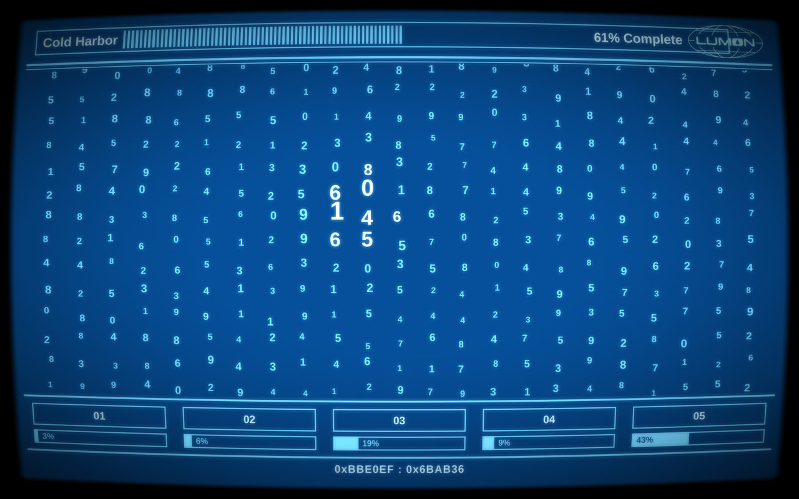
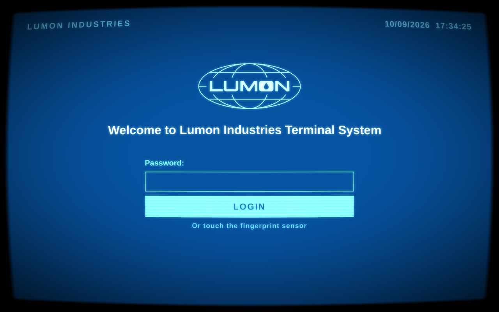

# Omarchy Lumon lock

A lock screen for [Omarchy](https://omarchy.org) that turns a locked session
into a Lumon terminal from *Severance*. It's a clone of Omarchy's own lock
plugin (`omarchy.lock`) with the view replaced and a few local changes.

| Locked and idle | After a key press |
|---|---|
|  |  |

- **Locked and idle**, it shows the interactive MDR screen from
  [mdr-screensaver](https://github.com/jarstelfox/mdr-screensaver): digits
  swell under the pointer, and clicking a scary cluster refines it.
- **A key press**, or a click anywhere outside the digit grid, fades it into
  the login. The first key only wakes it and doesn't go into the password.
- **The login** asks for the password only, shows a live clock, and offers
  the fingerprint sensor when one is set up. Ten seconds with nothing typed
  fades back to MDR.
- **Other local changes:** the displays stay lit for 10 minutes instead of 5
  seconds, and the pointer hides after 3 still seconds.

Password and fingerprint checking is Omarchy's, unchanged: `Service.qml`
talks to PAM exactly as the stock lock does.

## Install

The MDR screen ships inside this repo, so this is the only checkout needed.

```bash
git clone https://github.com/jarstelfox/omarchy-lumon-lock ~/.config/omarchy/plugins/lumon.lock
omarchy plugin disable omarchy.lock
omarchy plugin enable lumon.lock
omarchy restart shell
```

Preview it without locking (a click closes the preview):

```bash
omarchy-shell lock preview
```

Then try a real lock with `omarchy system lock`.

## If a lock ever gets stuck

Switch to a text console (Ctrl+Alt+F3), log in, put the last good version of
the view back, and restart the shell:

```bash
cd ~/.config/omarchy/plugins/lumon.lock
git checkout <last-good-commit> -- LockView.qml
omarchy restart shell
```

Switch back (Ctrl+Alt+F1 or F2). The restarted shell finds the session still
locked and locks it again with the restored view, so the password works as
usual. To go back to Omarchy's stock lock instead, run
`omarchy plugin enable omarchy.lock` and
`omarchy plugin disable lumon.lock`, then restart the shell.

## Changing the MDR screen

`MdrScreen.qml`, `crt.frag.qsb` and `lumon.svg` are copies from
[mdr-screensaver](https://github.com/jarstelfox/mdr-screensaver). Change them
there, then copy them in:

```bash
scripts/sync-mdr.sh           # from a checkout at ~/.config/quickshell/mdr (MDR_DIR overrides)
scripts/sync-mdr.sh --check   # only report files that differ
```

They're copies rather than symlinks because Omarchy refuses any symlink
inside a plugin folder: once a plugin is installed, the shell trusts that
folder and runs what's in it, and a link could point it at any file on disk.
`omarchy plugin add` and `omarchy plugin update` both check.

## Changing the view

Edits to `LockView.qml` don't reach the running lock until
`omarchy restart shell`. Test in this order, cheapest first:

1. `qs -n -p test`: the view with fake authentication (`lumon` unlocks).
   Never touches the real lock.
2. `omarchy restart shell`, then `omarchy-shell lock preview`.
3. A real lock, with the recovery steps above at hand.

## Credits and license

Built on Omarchy's lock plugin by David Heinemeier Hansson and the Omarchy
contributors, MIT licensed (see [LICENSE](LICENSE)).

A fan project. *Severance*, Lumon and the Lumon logo belong to their owners;
this repo isn't affiliated with or endorsed by them.
