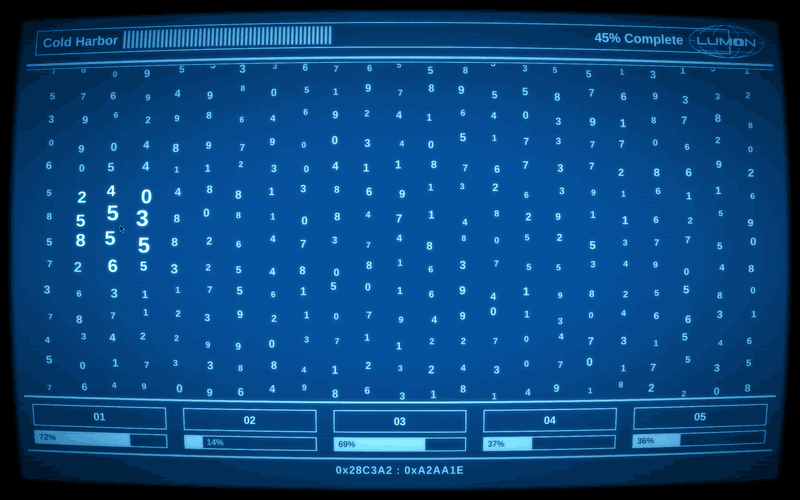
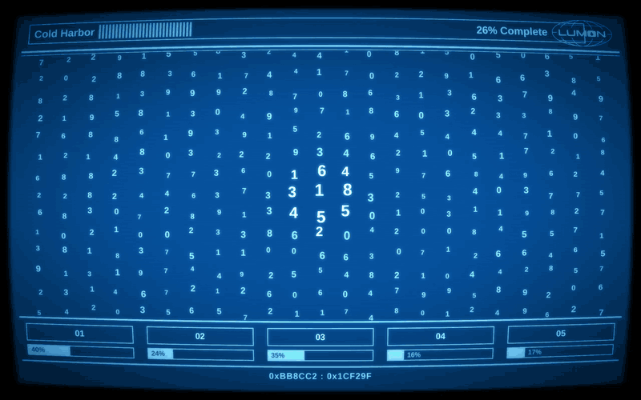
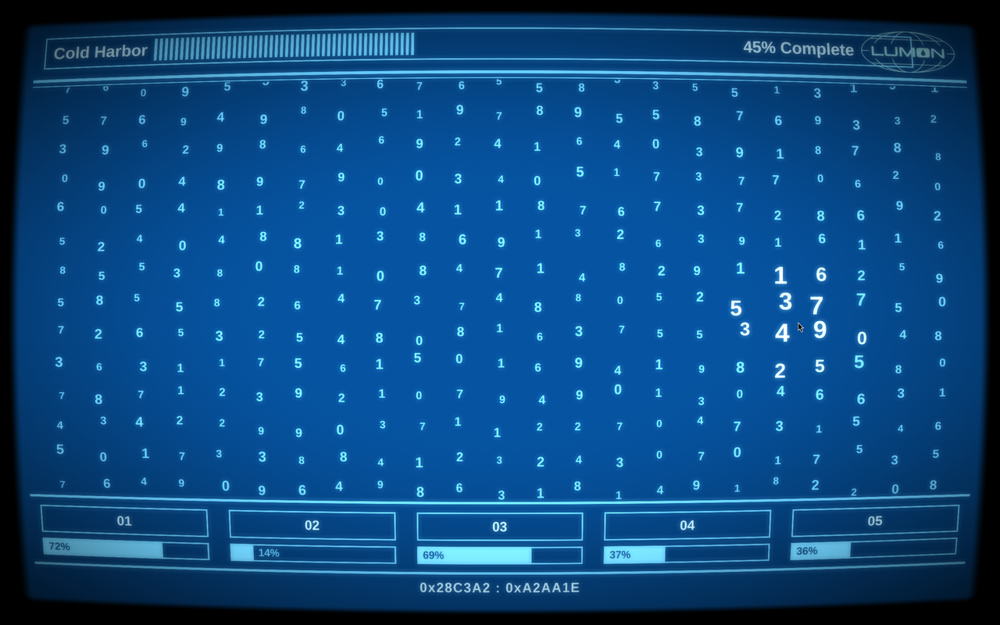
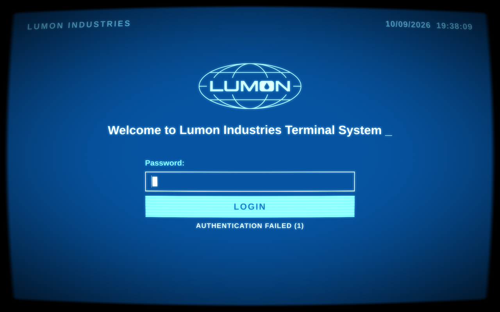

# Omarchy Lumon

The Macrodata Refinement screen from *Severance* as an interactive screensaver,
and a Lumon terminal login as the lock screen, for
[Omarchy](https://omarchy.org) (Hyprland, Quickshell).





| The MDR screen | The login | A failed attempt |
|---|---|---|
|  |  |  |

Move the pointer and the digits under it swell, like the refiners' terminals
in the show. Three clusters of "scary" numbers hide in the grid and jitter when
you get close. Click one and its digits fly into a bin, the lid flaps open, and
the file's progress goes up. Fill all five bins and the next file loads.

## Two ways to use it

**Screensaver only.** Nothing is installed into Omarchy; run the screen
whenever you like. Any key quits.

```bash
git clone https://github.com/jarstelfox/omarchy-lumon ~/src/omarchy-lumon
qs -n -p ~/src/omarchy-lumon/screensaver.qml
```

**Lock screen and screensaver together.** The repo is also an Omarchy plugin,
`lumon.lock`, that replaces Omarchy's lock screen. While locked and idle it
shows the MDR screen; a key press, or a click outside the digit grid, brings
up the login. Password and fingerprint checking are Omarchy's own, unchanged.

```bash
git clone https://github.com/jarstelfox/omarchy-lumon ~/.config/omarchy/plugins/lumon.lock
omarchy plugin disable omarchy.lock
omarchy plugin enable lumon.lock
omarchy restart shell
omarchy-shell lock preview      # see it without locking; a click closes it
```

Then try a real lock with `omarchy system lock`.

Needs Quickshell 0.3 or newer and the Liberation Sans font.

## On the lock screen

- The first key only wakes it; it doesn't go into the password.
- Escape, or a click outside the field with nothing typed, goes back to the
  MDR screen. So does waiting `loginTimeoutSeconds` with nothing typed.
- A failed password shows `AUTHENTICATION FAILED (n)`. The fingerprint
  sensor works too when one is set up.
- If the lock view can't load (a broken edit, say), a plain password field
  built into `Service.qml` takes its place, so the session still locks.

## Settings

Settings go on the plugin's entry in `~/.config/omarchy/shell.json`, next to
its id. The screensaver-only mode reads the same entry, if it's there. Changes
apply without a restart. Anything missing or out of range uses the default.

```json
"plugins": [
  { "id": "lumon.lock", "displayOffSeconds": 900, "crt": "subtle" }
]
```

| Setting | Default | Allowed | What it does |
|---|---|---|---|
| `displayOffSeconds` | 600 | 5 to 86400 | locked: turn the displays off after this long without input |
| `hidePointerSeconds` | 3 | 0 to 600 | locked: hide a still pointer after this long; 0 leaves it alone |
| `loginTimeoutSeconds` | 10 | 3 to 600 | locked: go back to the MDR screen after this long with nothing typed |
| `idleScreen` | `mdr` | `mdr`, `login` | locked and idle: the MDR screen, or just the login |
| `crt` | `full` | `full`, `subtle`, `off` | the curved CRT tube, bloom and scanlines |
| `clusters` | 3 | 1 to 8 | hidden scary-number clusters on the MDR screen |
| `files` | six MDR files | list of names | the file names the MDR screen works through |

When the lock starts the screensaver and how long until it locks are
Omarchy's own `idle.screensaver` and `idle.lock` settings.

For one screensaver run, `MDR_CRT=off` overrides `crt`, and
`MDR_FAKE_SIZE=1920x1080` lays the screen out as if it were that size.

## If a lock ever gets stuck

Switch to a text console (Ctrl+Alt+F3), log in, put a known-good version back,
and restart the shell:

```bash
cd ~/.config/omarchy/plugins/lumon.lock
git checkout <last-good-commit> -- Service.qml LockView.qml MdrScreen.qml Settings.js
omarchy restart shell
```

Switch back (Ctrl+Alt+F1 or F2). The restarted shell finds the session still
locked and locks it again with the restored files, so the password works as
usual. To go back to Omarchy's stock lock, run
`omarchy plugin enable omarchy.lock` and
`omarchy plugin disable lumon.lock`, then restart the shell.

## Changing it

Edits don't reach the running lock until `omarchy restart shell`. Test in this
order, cheapest first:

1. `node tests/settings.test.js` for the settings parser.
2. `qs -n -p test-lock.qml`: the lock view with fake authentication
   (`lumon` unlocks). Never touches the real lock.
3. `qs -n -p screensaver.qml` for the MDR screen.
4. `omarchy restart shell`, then `omarchy-shell lock preview`.
5. A real lock, with the recovery steps above at hand.

After editing `crt.frag`, rebuild the compiled shader:
`/usr/lib/qt6/bin/qsb --qt6 -o crt.frag.qsb crt.frag`.

## Credits and license

MIT (see [LICENSE](LICENSE)). `Service.qml` and the original lock view come
from Omarchy's lock plugin by David Heinemeier Hansson and the Omarchy
contributors, also MIT.

A fan project. *Severance*, Lumon, Macrodata Refinement and the Lumon logo
(`lumon.svg`) belong to their owners and aren't covered by the license; this
project isn't affiliated with or endorsed by them.
